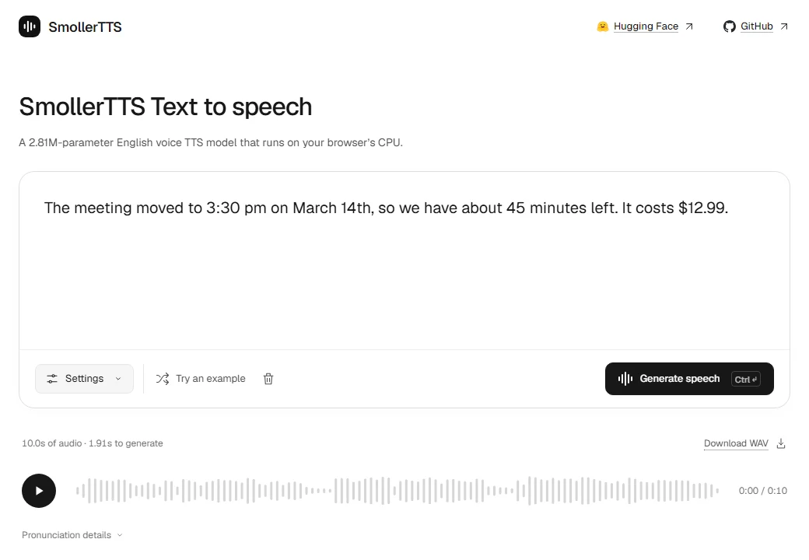

# SmollerTTS

A 2.81M-parameter English voice TTS model that runs on your browser’s CPU.

[Model weights](https://huggingface.co/dunli5107/SmollerTTS) · [Architecture](docs/model.md) · [Evaluation](docs/evaluation.md) · [Credits](THIRD_PARTY.md)

SmollerTTS generates 22.05 kHz speech locally using ONNX Runtime Web. The acoustic model was trained from scratch on LJSpeech; the waveform generator uses pretrained **HiFi-GAN LJ_V2** weights. No inference server or GPU is needed.



| Component | Parameters | Download size |
| :--- | ---: | ---: |
| Acoustic model | 1,882,807 | 7.59 MB |
| HiFi-GAN vocoder | 925,985 | 3.74 MB |
| **Total neural weights** | **2,808,792** | **11.34 MB** |

The voice assets, including the WebAssembly runtime and pronunciation files, total about **30.14 MB** uncompressed. These are file sizes, not peak RAM usage. Weights use FP32.

## Run locally

Install Node.js 22.12 or newer, then:

```sh
git clone https://github.com/Ehdunhackme/SmollerTTS.git
cd SmollerTTS
npm ci
npm run setup
npm run build
npm start
```

Open **http://127.0.0.1:5175/projects/smollertts/**. Setup downloads the published weights and runtime from a pinned Hugging Face revision and verifies every file’s SHA-256. Python, CUDA and a Hugging Face account are not required.

The demo includes chunked playback, WAV download, speed/pitch/energy controls and a pronunciation dictionary. Dates, times, money and common units are expanded before synthesis. Unfamiliar words use a phonemizer; compound splitting is limited to a small tested list so ordinary words retain their pronunciation.

Entered text is processed in the browser. On first load, the browser downloads model files from the server hosting the demo and caches them when storage is available.

## How it works

```text
Text → normalization & phonemes → text encoder
                                   ├─ duration prediction
                                   └─ pitch, voicing & energy
                                              ↓
                                     length regulation
                                              ↓
                                  frame decoder → mel features
                                              ↓
                                     HiFi-GAN → waveform
```

The acoustic network uses four attention/convolution blocks and six small frame blocks, with a hidden width of 160. Inference is split into three ONNX graphs: encoder, frame decoder and vocoder. The demo has an interactive diagram of the complete architecture.

[Model details](docs/model.md) describe the layers, parameter count and browser execution. [Training notes](docs/training.md) describe the final acoustic recipe and the scope of the included Python source.

## Speech quality vs. model size (rough)

On the four English prompts used by the demo’s published comparison overview, SmollerTTS scores **3.55 UTMOS** and **6.69% mean prompt WER**. The WAVs, transcripts and per-prompt results are included in [benchmarks](benchmarks/).

UTMOS estimates quality; it is not human MOS. Four sentences cannot establish a reliable naturalness ranking. The chart combines our browser output with published peer scores using different voices and runtimes. A separate 48-sentence comparison and its limitations are documented in [evaluation](docs/evaluation.md).

This is a compact, single-voice English model. Names, unfamiliar words and long passages can still sound unnatural or be mispronounced. Delivery controls adjust the same voice; they do not provide speaker cloning or trained emotional styles.

## Development

```sh
npm test
npm run build
```

The browser regression test checks the four benchmark WAVs, the units example, responsive layout and cached loading. With the local server running:

```sh
pip install playwright==1.64.1
python -m playwright install chromium
python tests/browser_smoke.py
```

- `web/` — interface, pronunciation frontend and browser inference.
- `smollertts/` — PyTorch acoustic architecture, vocoder definition and acoustic training components.
- `model/` — model configuration and pinned asset manifest.
- `benchmarks/` — measurements, prompts and example audio.
- `scripts/` — verified asset download, static build and local server.
- `docs/` — architecture, evaluation, training and hosting notes.

The build writes `dist/projects/smollertts/`. See [deployment](docs/deployment.md) for static hosting. Generated files, downloaded weights, training data and checkpoints are kept out of Git.

## License & attribution

Original code and acoustic weights are MIT licensed. HiFi-GAN, ONNX Runtime, pronunciation resources and the Geist font retain their own licenses and attribution; see [THIRD_PARTY.md](THIRD_PARTY.md).

By [Dun Li Chan](https://dunlichan.com/).

```bibtex
@software{chan2026smollertts,
  author = {Chan, Dun Li},
  title = {SmollerTTS},
  year = {2026},
  url = {https://github.com/Ehdunhackme/SmollerTTS}
}
```
